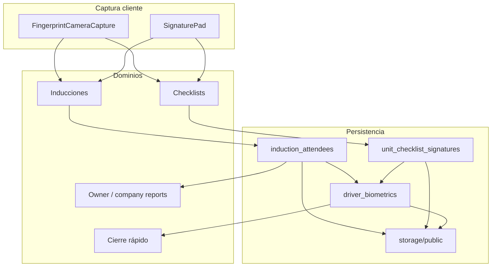
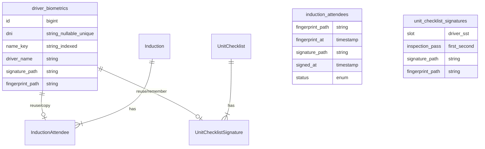
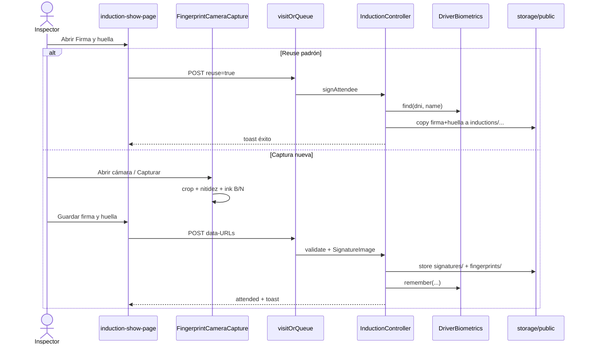

# Huelleros / huellas en Agrovision — guía completa

Documento de referencia del sistema de **huellas**: qué es en este producto, cómo captura, dónde se guarda, cómo se reutiliza y qué no es.

**Hallazgo clave:** no existe un módulo CRUD llamado “huelleros”, ni trackers de neumáticos. En Agrovision **“huella” = foto cercana de la yema del dedo**, procesada en el celular a estilo “impresión de tinta” y guardada como PNG. No hay matching biométrico, lector USB ni SDK forense.

---

## Resumen ejecutivo

El flujo de huellas es **transversal**:

| Pieza | Rol |
|-------|-----|
| `FingerprintCameraCapture` | Cámara + nitidez + pipeline B/N “impresión” |
| `SignaturePad` | Firma con el dedo (par obligatorio en inducciones) |
| `driver_biometrics` | Padrón por DNI / nombre para **reutilizar** firma+huella |
| Inducciones | Firma **y** huella obligatorias al firmar asistente |
| Checklists | Huella **opcional** solo en slot `driver` |
| PDFs / reportes | Recibos de inducción y KPI “Firma y huella”; PDF de checklist **no** pinta la huella |

Alcohol / alcohómetro y ítems de “llantas” son dominios vecinos de flota/SST, **sin relación** con este flujo.

---

## 1. Dominio de negocio

| Concepto | Qué es aquí |
|----------|-------------|
| **Huella** | Foto de cerca del dedo → imagen B/N estilo tampón, PNG en disco `public` |
| **Firma + huella** | Par de evidencia en inducciones (asistencia). En inspecciones la huella del conductor es opcional |
| **Huella guardada / reutilizar** | Copia desde `driver_biometrics` sin volver a capturar |
| **Huellero (conversacional)** | Objetivo de calidad visual (“que se vean los surcos”), no entidad de código |
| **No es** | Sensor nativo, 1:N matching, liveness, certificación legal forense |

### Copy de producto (UI)

- Inducción: *“La huella es una foto de cerca: llena el círculo con la yema y captura.”*
- Captura: *“Es una sola foto, no un video.”* / *“Huella lista. Si no se ven los surcos, vuelve a tomarla.”*
- Reportes: *“Firma y huella”* / *“Firmaron y pusieron huella”*

---

## 2. Arquitectura y mapa de archivos

### Capas



### Backend

| Path | Rol |
|------|-----|
| `app/Support/DriverBiometrics.php` | Padrón: find / remember / copy; lookup DNI/nombre; backfill histórico |
| `app/Models/DriverBiometric.php` | Eloquent del padrón |
| `app/Support/SignatureImage.php` | Data-URL → archivo en disk `public` (firma y huella) |
| `app/Models/InductionAttendee.php` | `fingerprint_path`, `fingerprint_at`; URLs; borrado en cascade |
| `app/Models/UnitChecklistSignature.php` | `fingerprint_path` en firmas de inspección |
| `app/Http/Controllers/InductionController.php` | `signAttendee` (reuse / capture / clear) |
| `app/Http/Controllers/InductionQuickCompleteController.php` | Cierre rápido: solo DNIs con firma+huella en padrón |
| `app/Support/InductionQuickComplete.php` | Candidatos = activos + biometrics completos − ya cubiertos |
| `app/Http/Controllers/ChecklistController.php` | Props + update + `remember` |
| `app/Http/Requests/UpdateUnitChecklistRequest.php` | Valida `fingerprint_data_url` / `clear_fingerprint` |
| `app/Support/InductionDocumentPackage.php` | PDF: `fingerprint_src` en recibos |
| `app/Support/OwnerReports.php` | “Signed” = firma **y** huella |

### Migraciones tenant

| Path | Qué agrega |
|------|------------|
| `database/migrations/tenant/2026_07_14_220000_add_fingerprint_to_induction_attendees_table.php` | Huella en asistentes |
| `database/migrations/tenant/2026_10_12_000022_create_driver_biometrics_table.php` | Tabla padrón |
| `database/migrations/tenant/2026_10_18_000024_add_fingerprint_path_to_unit_checklist_signatures.php` | Huella en firmas checklist |

### Frontend

| Path | Rol |
|------|-----|
| `resources/js/components/inductions/fingerprint-camera-capture.tsx` | Cámara + nitidez + pipeline “impresión” |
| `resources/js/components/inductions/induction-show-page.tsx` | Modal firma+huella; reuse; `visitOrQueue` |
| `resources/js/components/checklists/checklist-edit-form.tsx` | Huella opcional solo slot `driver` |
| `resources/js/components/checklists/signature-pad.tsx` | Firma; `mode: 'stamp'` existe pero **no se usa** en captura real |
| `resources/js/pages/inductions/quick-complete.tsx` | UI cierre rápido |
| `resources/js/components/company-reports/inductions-tab.tsx` | KPI firma+huella |
| `resources/js/components/company-reports/consolidated-tab.tsx` | Idem consolidado |
| `resources/js/lib/offline/induction-cache.ts` | Prefetch de URLs de huella/firma |
| `resources/js/lib/offline/store.ts` | Snapshot limpia `fingerprint_url` en drafts locales |

### PDFs

| Path | Huella |
|------|--------|
| `resources/views/pdfs/induction-risst-receipt.blade.php` | Caja “Huella” |
| `resources/views/pdfs/induction-ritran-receipt.blade.php` | Idem |
| `resources/views/pdfs/owner-report.blade.php` | Columna “Firma y huella” |
| `resources/views/pdfs/checklist-report.blade.php` | **Solo firma** (no renderiza huella) |

### Ausencias relevantes

- Sin Policy dedicada a biometrics/huellas
- Sin Job/cola de procesamiento de huellas
- Sin página CRUD “Huelleros” en el sidebar
- `TenantTables::names()` **no lista** `driver_biometrics` (la migración sí existe)

---

## 3. Modelo de datos



### `driver_biometrics` (padrón tenant)

- **Lookup:** DNI (solo dígitos) → si no, `name_key` (nombre normalizado sin tildes).
- **Storage:** `drivers/biometrics/dni-{digits}/…` o `name-{sha1}/…`.
- `DriverBiometrics::ensure()` puede crear la tabla al vuelo si falta.
- `remember()` copia firma/huella al padrón cuando se capturan en inducción o checklist.

### `induction_attendees`

- Paths: `inductions/{id}/fingerprints/firma_*.png`
- Al firmar: `status → attended`; setea `attended_at` si vacío.
- Tiene `fingerprint_at` (auditoría).

### `unit_checklist_signatures`

- Paths: `checklists/{id}/fingerprints/…`
- Solo la UI de huella aparece si `slot === 'driver'`.
- **Sin** `fingerprint_at`.

### Estados involucrados

| Entidad | Valores | Relación con huella |
|----------|---------|---------------------|
| Inducción | `draft`, `scheduled`, `in_progress`, `closed`, `cancelled` | Firma/huella solo si `in_progress`; bloqueado si locked |
| Asistente | `registered`, `attended`, `absent` | Captura → `attended` |
| Checklist pass | `first` / `second` | Huella por pass/slot |
| “Firmado” en reportes | firma **y** huella | `OwnerReports` |

---

## 4. Captura en el cliente

Componente: `FingerprintCameraCapture`.

### Pipeline típico

1. Elige cámara (prioriza macro / rear; penaliza selfie).
2. Guía circular: el usuario llena el círculo con la yema.
3. Captura **una** foto (no video).
4. Crop del área guía.
5. Score de nitidez (`MIN_SHARPNESS = 48`); si falla, pide reintentar.
6. Procesa a estilo “impresión” B/N (surcos visibles).
7. Emite data-URL PNG al padre (`onChange`).

### Firma

`SignaturePad`: trazo con dedo/mouse. En inducciones va **junto** a la huella en el mismo modal. El `mode: 'stamp'` del pad dibuja una huella sintética; **ningún flujo real lo usa** — la captura real es siempre cámara.

---

## 5. Flujos UX

### Inducciones (flujo principal)



1. Listar `/inducciones` → abrir show.
2. **Iniciar** inducción (`in_progress`).
3. Jalar / gestionar asistentes.
4. Modal **Firma y huella** (pad + cámara, o “Usar guardadas”).
5. Guardar → POST; marca asistencia.
6. PDF / recibos muestran huella.
7. **Cierre rápido** (`/inducciones/cierre-rapido`): solo conductores activos con ambos archivos en padrón y sin ese tipo de inducción.

### Checklists

1. Editar inspección → firmas por pass.
2. Slot conductor: firma + *“¿Guardar huella también?”*.
3. Puede reusar `saved_fingerprint_url` del padrón.
4. Viaja en el mismo PUT de la inspección.
5. PDF de checklist **no incluye** la imagen de huella.

### Capacidades

| Capacidad | Inducciones | Checklists | Padrón biometrics |
|-----------|-------------|------------|-------------------|
| Captura cámara | Obligatoria con firma | Opcional (driver) | Implícito vía remember |
| Reuse guardada | Sí (exige ambos archivos) | Sí (driver) | Fuente |
| Preview URL | Sí | Sí | Solo embebido |
| PDF con huella | Recibos RISST/RITRAN | **No** | — |
| Reportes / KPI | Owner + company | — | Filtro quick-complete |
| UI CRUD propia | — | — | **No existe** |
| Offline | `visitOrQueue` + snapshot | outbox data-URL | Sin sync propio |

---

## 6. API / rutas

Rutas en `routes/tenant.php`:

| Método | Ruta | Acción | Notas |
|--------|------|--------|-------|
| POST | `/inducciones/{induction}/asistentes/{attendee}/firma` | `signAttendee` | Captura / reuse / clear |
| POST | `/inducciones/{induction}/firma-expositor` | Firma expositor | **Sin** huella |
| GET | `/inducciones/{induction}/pdf` | Paquete PDF | Incluye huellas |
| GET/POST | `/inducciones/cierre-rapido` | Quick complete | Exige firma+huella en padrón |
| PUT/PATCH | `/inspecciones/{checklist}` | Update inspección | Firmas + huellas opcionales |
| GET | `/inspecciones/{checklist}/pdf` | PDF checklist | **Sin** huella |

### Payload `signAttendee`

| Modo | Campos |
|------|--------|
| Captura | `signature_data_url` + `fingerprint_data_url` (required) |
| Reuse | `reuse=true` (padrón debe tener ambos paths) |
| Clear | `clear_signature` → limpia firma **y** huella |

### Props Inertia típicas

- Asistente / firma: `fingerprint_url`, `has_fingerprint`, `saved_fingerprint_url`
- Checklist driver: `fingerprint_url`, `saved_fingerprint_url` si aún no hay path local

---

## 7. Validaciones, permisos, multi-tenant

### Validaciones

- Inducción: data-URL required; imagen vía `SignatureImage` (png/jpeg/webp, ≤ ~8 MB).
- Checklist: `fingerprint_data_url` nullable; **no** obliga huella para sellar.
- Gate: inducción no locked + `allowsAttendanceActions()` (= `in_progress`).

### Permisos

- No hay permiso `*.fingerprint`.
- Hereda de `inductions.*` / `checklists.*`.
- Cierre rápido: `inductions.quick_complete`.

### Multi-tenant

- Tablas y archivos viven en el tenant.
- `DriverBiometrics` es per-tenant (no central).
- Falta `driver_biometrics` en `TenantTables::names()` → riesgo en dumps/ops que lean esa lista.

---

## 8. Relación con offline

Detalle en [`docs/offline.md`](./offline.md). Resumen:

| Aspecto | Comportamiento |
|---------|----------------|
| Inducción show | Snapshot IDB + `visitOrQueue` encola POST (data-URLs grandes) |
| Prefetch | `induction-cache.ts` cachea `fingerprint_url` / `saved_*` |
| Checklists | Firmas/huellas en `outbox` update como data-URL |
| Cámara | Requiere dispositivo/permisos; offline no inventa captura |
| Gaps | Cuota IndexedDB; IDs temporales de asistentes pueden romper firma hasta sync |

No hay store Dexie específico de biometrics ni sync de padrón aparte.

---

## 9. Relación con otros módulos

| Módulo | Relación |
|--------|----------|
| **Units / Drivers** | Identidad (DNI/nombre) para lookup del padrón y candidatos quick-complete |
| **Blacklist / Alcohol** | Comparten “conductor”; **no** capturan huella |
| **PDF inducción** | Huella en recibos; paquete incluye `fingerprint_path` |
| **Pareto / llantas** | Solo ítems de inspección de vehículo; no son “huelleros” |
| **Offline** | Cola de mutaciones + prefetch de media; ver doc offline |

---

## 10. Limitaciones y riesgos

1. **No es huellero forense** — evidencia visual; sin matching ni certificación.
2. **PDF de checklist omite huella** aunque esté en BD.
3. **`SignaturePad` mode `stamp`** — código muerto confuso.
4. **Backfill histórico** — puede recuperar firma de checklist pero no siempre `fingerprint_path` de inspección.
5. **Huella checklist sin `fingerprint_at`**.
6. **Servidor no valida “calidad de surcos”** — solo que el data-URL sea imagen válida.
7. **Offline + PNG procesado** — peso en IndexedDB.
8. **`TenantTables` sin `driver_biometrics`**.
9. **Reuse exige ambos archivos** — si solo hay firma, no ofrece reuse.
10. **Nombre sin DNI** — colisiones entre homónimos.
11. **Torch/zoom/focus** best-effort; calidad muy dependiente del teléfono.
12. No buscar un CRUD “Huelleros” en el menú: no existe.

---

## 11. ¿Hay algo mejor?

### Qué está bien

- Flujo de campo práctico: foto + guía circular + nitidez mínima.
- Padrón `driver_biometrics` evita re-capturar en cada inducción.
- Cierre rápido filtra solo quien ya tiene firma+huella.
- Offline de inducciones contempla firma/huella vía `visitOrQueue`.

### Recomendaciones priorizadas

| Prioridad | Mejora |
|-----------|--------|
| **P0** | Incluir huella del conductor en PDF de checklist **o** documentar que es solo archivo interno |
| **P0** | Copy claro: “huella fotográfica de evidencia”, no “huellero biométrico certificado” |
| **P1** | Añadir `driver_biometrics` a `TenantTables` y a dumps/ops |
| **P1** | Backfill histórico también de `fingerprint_path` de inspecciones |
| **P1** | Comprimir / limitar data-URL antes de encolar offline |
| **P2** | Eliminar o cablear `mode: 'stamp'` |
| **P2** | `fingerprint_at` + auditoría en firmas de checklist |
| **P2** | Guía UX “tampón en papel → foto” si el cliente exige surcos imprimibles |
| **P3** | UI admin mínima del padrón (ver/borrar por DNI) |
| **P3** | Matching real solo con SDK nativo de pago (fuera del alcance actual) |

### Alternativas vs lo actual

| Enfoque | Veredicto |
|---------|-----------|
| **Foto + pipeline B/N (actual)** | Adecuado para evidencia SST / PDF en campo |
| **Lector USB / SDK biométrico** | Otro producto: hardware, drivers, matching, compliance |
| **WebAuthn / passkeys** | Autenticación, no evidencia de yema en acta |
| **Solo firma sin huella** | Más simple, pero pierdes el KPI y el requisito de inducción |

**Conclusión:** no hace falta un módulo “huelleros” aparte. El diseño actual (captura + padrón + reuse) es el correcto para Agrovision. Lo útil es cerrar gaps de PDF, tablas tenant, offline weight y claridad de producto.

---

## 12. Checklist operativo en campo

1. Empezar la inducción (`in_progress`) antes de pedir firmas/huellas.
2. Luz decente; llenar el círculo con la yema; si no se ven surcos, volver a capturar.
3. Preferir conductores con DNI cargado (mejor lookup del padrón).
4. Tras la primera captura exitosa, en siguientes sesiones usar **“Usar firma y huella guardadas”**.
5. Para cierre rápido: solo aparecen quienes ya tienen ambos archivos en padrón.
6. Offline: la captura sigue siendo posible en dispositivo; el POST queda en cola hasta sincronizar (ver `docs/offline.md`).

---

## 13. Puntos de entrada en código

```php
// Padrón
DriverBiometrics::remember($dni, $name, $signaturePath, $fingerprintPath);
DriverBiometrics::find($dni, $name);
```

```tsx
// Captura UI
import { FingerprintCameraCapture } from '@/components/inductions/fingerprint-camera-capture';
```

```php
// Persistencia de data-URL
SignatureImage::storeFromDataUrl($dataUrl, "inductions/{$id}/fingerprints");
```

---

*Generado a partir del código del repo Agrovision. Complementa [`docs/offline.md`](./offline.md).*
