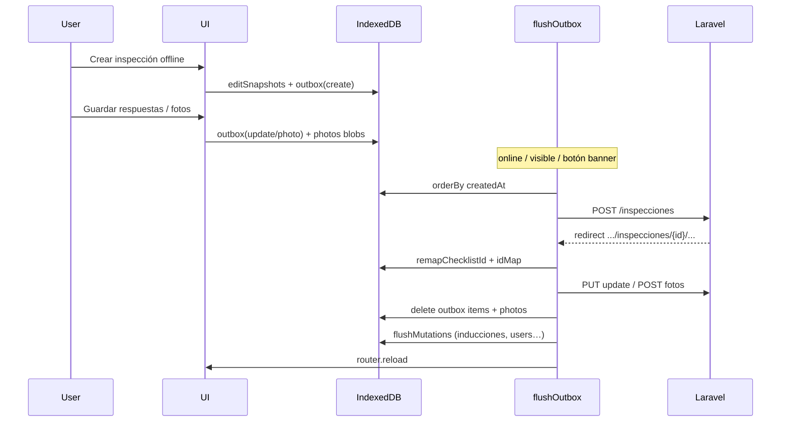
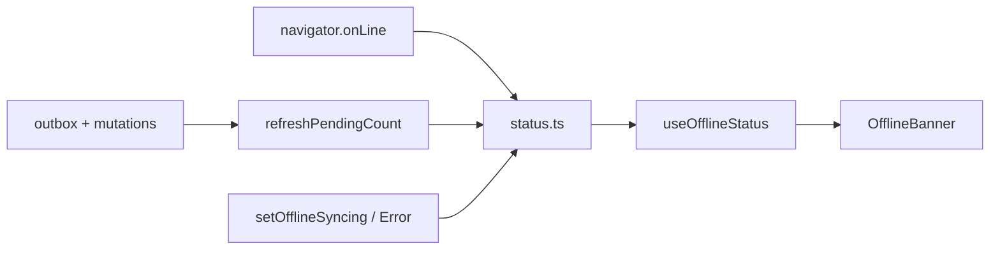
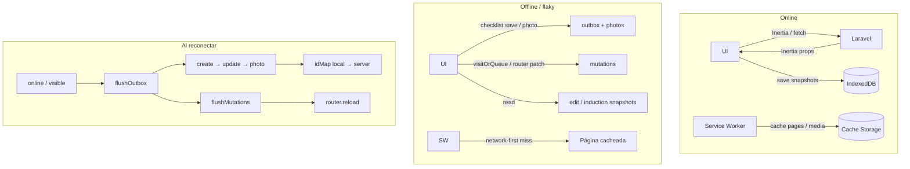

# Offline en Agrovision — guía completa

Documento de referencia del modo offline: cómo está armado hoy, qué puedes hacer sin red, límites reales y qué conviene mejorar.

**Stack actual:** IndexedDB (Dexie) + Service Worker (`/sw.js`) + sync en foreground (al volver online o al abrir la app). No usa Background Sync API ni Workbox.

---

## Resumen ejecutivo

Agrovision offline es una arquitectura **híbrida pensada para campo** (señal intermitente, no solo “sin internet”):

1. **Dexie / IndexedDB** guarda snapshots, fotos blob y **dos colas** de trabajo pendiente.
2. **Service Worker** cachea shell, páginas Inertia y medios para poder abrir pantallas ya visitadas.
3. **Sync en primer plano** (`flushOutbox`) empuja la cola cuando `navigator.onLine` y la pestaña está visible (o el usuario pulsa “Sincronizar”).

El dominio más maduro es **inspecciones (checklists)**. **Inducciones** van por snapshots + `visitOrQueue`. El resto del tenant (users, roles, places, etc.) aprovecha un **parche global del router Inertia**.

---

## 1. Arquitectura
 
### Capas

| Capa | Rol |
|------|-----|
| Bootstrap (`resources/js/app.tsx`) | Arranca `startOfflineSync()` |
| Blade / SW (`resources/views/app.blade.php`, `public/sw.js`) | Registra Service Worker + PWA |
| Lib (`resources/js/lib/offline/*`) | Persistencia, colas, red, sync |
| UI | `OfflineBanner`, hooks de estado, filas `pending_sync` |
| Backend | Prop `offlineCatalog` en índice de inspecciones; resto = endpoints normales |

### Mapa de archivos

#### Core — `resources/js/lib/offline/`

| Archivo | Responsabilidad |
|---------|-----------------|
| `db.ts` | Dexie DB `agrovision-offline`, stores y tipos |
| `store.ts` | Snapshots, outbox helpers, drafts, pending count |
| `mutations.ts` | Cola genérica + parche del router Inertia |
| `sync.ts` | `flushOutbox` / `startOfflineSync` / remap de IDs |
| `visit-or-queue.ts` | Inertia con fallback a cola (red flaky) |
| `network.ts` | Detección de fallos de red + `fetchWithNetworkRetry` |
| `status.ts` | Estado en memoria (online / pending / syncing / error) |
| `ids.ts` | IDs `local-*` / `photo-*` / `outbox-*`, `isBrowserOnline` |
| `errors.ts` | Mensajes + `maxSyncAttempts = 8` |
| `preload.ts` | Prefetch HTML/Inertia de rutas tenant |
| `induction-cache.ts` | Prefetch show + media de inducciones |
| `use-pending-posts.ts` | Hook de POSTs pendientes por URL |

#### UI / hooks

- `resources/js/hooks/use-offline-status.ts`
- `resources/js/components/offline/offline-banner.tsx`
- Layout tenant: `resources/js/layouts/app/app-sidebar-layout.tsx` (banner + preload)

#### PWA

- `resources/js/lib/register-service-worker.ts`
- `public/sw.js` (versión de cache `agrovision-pwa-v11`)
- `public/manifest.webmanifest`

#### Consumidores principales

- **Checklists:** `checklists-page`, `checklist-create-modal`, `checklist-edit-form`, `checklist-photos-section`, `pages/checklists/edit`
- **Inducciones:** `inductions-page`, `induction-show-page`, `pages/inductions/show`
- **CRUD genérico:** users / roles / places / units / periods / pareto / alcohol (router parcheado + `usePendingPosts`)

#### Backend

- `app/Http/Controllers/ChecklistController.php` → prop Inertia `offlineCatalog` (plantillas + ítems + firmas + pesos Pareto)

---

## 2. Persistencia (IndexedDB / Dexie)

Base de datos: **`agrovision-offline`** (Dexie ^4.4.6).

### Stores

| Store | Clave | Índices | Contenido |
|-------|-------|---------|-----------|
| `indexSnapshots` | `key` (`'index'`) | `updatedAt` | Lista inspecciones + filtros + `catalog` |
| `editSnapshots` | `key` (`edit:{id}`) | `updatedAt` | Form completo de inspección |
| `outbox` | `id` (`outbox-…`) | `kind`, `checklistId`, `createdAt` | Mutaciones de checklist |
| `photos` | `id` (`photo-…`) | `checklistId`, `inspectionPass` | Blobs locales |
| `idMap` | `localId` | `serverId` | `local-*` → ID servidor |
| `mutations` | `id` | `createdAt`, `url` | Cola genérica Inertia/fetch |
| `inductionSnapshots` | `key` (`induction:{id}`) | `updatedAt` | Props del show |

Versiones Dexie: **v1** checklists → **v2** `mutations` → **v3** `inductionSnapshots`.

### Dos colas (importante)

1. **`outbox`** — solo inspecciones: `create` \| `update` \| `photo` \| `delete-photo`.
2. **`mutations`** — todo lo demás (inducciones, usuarios, etc.) + DELETE offline de inspección ya existente en servidor.

`refreshPendingCount()` = `outbox.count() + mutations.count()`.

### Fotos locales

Tipo `OfflinePhoto`: blob JPEG, pass (`first`/`second`), geo opcional, `checklistItemId`. Se muestran con `URL.createObjectURL`. Tras sync exitoso se borran del store.

### Snapshots

| Snapshot | Cuándo se escribe | Cuándo se lee |
|----------|-------------------|---------------|
| **Index** | Al ver `/inspecciones` | **Hoy casi no se consume** (`getIndexSnapshot` sin uso real en UI) |
| **Edit** | Al abrir edit online, prefetch de filas, antes de cada save | Al editar offline / IDs locales |
| **Induction** | Al ver show online + al mutar offline (`persistDraft`) | En `pages/inductions/show` si no hay red |

> Gap: el snapshot de índice existe en IDB, pero el listado offline depende sobre todo del **cache del Service Worker**. Si el SW no tiene la página, React no restaura desde `indexSnapshots`.

---

## 3. Detección de red

```ts
// ids.ts
export function isBrowserOnline(): boolean {
    return typeof navigator === 'undefined' ? true : navigator.onLine;
}
```

| Mecanismo | Uso |
|-----------|-----|
| `navigator.onLine` + eventos `online`/`offline` | UI (`useOfflineStatus` → banner) |
| `online` + `visibilitychange` | Disparan `flushOutbox()` |
| `isNetworkFailure` | TypeError / Abort / Timeout → **no quema intentos** ni borra cola |
| `fetchWithNetworkRetry` | 3 intentos, timeout 25–45s, backoff, retry en CSRF 419 |

**Diseño clave:** `navigator.onLine === true` no garantiza conectividad real. Por eso checklists e inducciones hacen **try-network → si falla, queue-local** (red flaky ≠ “modo offline declarado”).

---

## 4. Cola genérica (`mutations.ts`)

### `enqueueMutation`

- **POST** → id `local-{uuid}`, body con `__localId`.
- **PUT/PATCH** a URL con `local-…` → **merge** en la mutación POST existente (no crea ítem nuevo).
- **DELETE** a `local-*` → **cancela** la mutación local (nunca llega al servidor).
- **FormData** → strings + `__files: { key, blob, filename }[]` serializados en IDB.

### `flushMutations`

1. Orden por `createdAt`.
2. Reconstruye JSON o FormData (spoof `_method` si no es POST).
3. Fallo de red → `break` (no quema intentos).
4. Error duro → `attempts++`; si `>= 8` el ítem **sigue en cola** con error visible.
5. Éxito → delete; al final puede disparar `router.reload`.

### `installOfflineRouter`

Parchea `router.post | put | patch | delete`:

| Condición | Comportamiento |
|-----------|----------------|
| Online | Llama al router original |
| Offline + URL con `/local-…/` | Toast de error (el registro aún no existe en servidor) |
| Offline | `enqueueMutation` + toast + dispara `onSuccess` / `onFinish` **de forma optimista** |

Se activa una sola vez en `startOfflineSync()`.

> Cuidado: callers que confían en `onSuccess` como “confirmado en servidor” pueden equivocarse offline.

---

## 5. Sync de inspecciones (`sync.ts`)

### Arranque — `startOfflineSync`

1. `installOfflineRouter()`
2. Listeners `online` + `visibilitychange`
3. `refreshPendingCount()`
4. Si online → `flushOutbox()`

### `flushOutbox` — orden



1. Procesa **outbox** por `createdAt`.
2. Si falla un `create`, marca el checklist en `blockedChecklists` y no procesa update/fotos de ese id.
3. Luego `flushMutations()`.
4. Si hubo sync de outbox → `router.reload`.

### Por `kind`

| Kind | Acción | Remap |
|------|--------|-------|
| `create` | `POST /inspecciones` JSON | Parsea ID de `response.url` (`/inspecciones/{id}`), `remapChecklistId` |
| `update` | `PUT /inspecciones/{resolved}` | Usa `idMap` si era `local-*` |
| `photo` | `POST …/fotos` multipart desde blob | Borra photo local |
| `delete-photo` | `DELETE …/fotos/{id}` | Solo si `photoId` es numérico (servidor) |

`remapChecklistId`: transacción que mueve snapshot, fotos y outbox de `local-*` → id servidor + escribe `idMap`.

---

## 6. `visit-or-queue.ts` (inducciones / red flaky)

Patrón más robusto que el router “solo offline”:

1. Si ya offline → encola de inmediato.
2. Si online → registra la visita en un mapa pendiente y llama `router[method]`.
3. Si llega `router.on('networkError')` → encola todos los pending + toast + `flushOutbox`.
4. `onQueued` actualiza UI/snapshot local (asistentes temporales, firmas, etc.).

Cubre **caída a mitad de petición**, no solo el caso “ya estaba offline”.

---

## 7. Capacidades por dominio

| Dominio | Offline sí | Offline no / limitado |
|---------|------------|------------------------|
| **Checklists – crear** | Draft local + `queueCreate` si hay `offlineCatalog` | Sin catalog previo (hay que abrir el índice **online** al menos una vez) |
| **Checklists – editar** | Snapshot + `queueUpdate` (respuestas, firmas data-URL, metadatos) | **Sellar** exige online |
| **Checklists – fotos** | Blob en IDB + outbox; evidencia y fotos de pass | PDF / export online |
| **Checklists – listar** | SW cache + drafts locales mergeados | Snapshot de índice no restaura React si el SW falla |
| **Inducciones – show** | Snapshot + `visitOrQueue` (asistentes, estado, firmas, foto verif.) | Búsqueda de unidades; copiar; crear inducción nueva no se abre hasta sync |
| **Inducciones – crear** | Via router parcheado → `mutations` + filas pending | No editable hasta sincronizar |
| **Users / roles / places / units / periods / pareto / alcohol** | POST/PUT/DELETE offline vía router; UI pending en varios listados | Filtros/paginación GET bloqueados; editar `local-*` bloqueado |
| **Sellado / coordinador / batch / export** | — | Requieren red |
| **Central (multi-tenant admin)** | Banner oculto | Sin offline de tenant |

---

## 8. UI y estado



### `OfflineBanner` (solo layout tenant)

Tono según estado: offline / syncing / error / pending.

| Acción | Efecto |
|--------|--------|
| **Sincronizar** | `flushOutbox()` |
| **Quitar** (si hay `lastError`) | `discardAllPending` — borra outbox, mutations, photos, idMap y drafts locales |

Evento `agrovision:mutations` refresca listas con filas pendientes.

> `discardAllPending` es **destructivo global**. No es “limpiar un ítem fallido”; es vaciar toda la cola del dispositivo.

---

## 9. Preload y Service Worker

### `preload.ts`

Al montar layout tenant calienta rutas (`/dashboard`, `/inspecciones`, `/inducciones`, …) en HTML + petición Inertia → llena **PAGES_CACHE** del SW.

### `induction-cache.ts`

Prefetch Inertia JSON de cada show → `saveInductionSnapshot` + fetch de media nuevas + HTML.

### Prefetch de edits

En listado de inspecciones se prefetch `/inspecciones/{id}/editar` → `saveEditSnapshot` (si no hay búsqueda activa).

### Service Worker (`public/sw.js`)

| Recurso | Estrategia |
|---------|------------|
| Páginas / Inertia app | Network-first → cache |
| Assets `/build/` | Cache-first |
| Media `/storage/checklists\|inductions\|drivers/` | Cache-first |
| Documento sin cache | HTML “Sin conexión” (503) |

También maneja push notifications. **No** escucha el evento `sync` (Background Sync).

---

## 10. Backend

Único prop offline explícito: **`offlineCatalog`** en el índice de inspecciones — plantillas con ítems, `allows_photo`, roles de firma, totales Pareto.

El resto son endpoints normales:

- `POST` / `PUT` `/inspecciones`, fotos…
- Rutas `/inducciones/...`
- CRUDs tenant

El create offline depende de que la respuesta de store redirija a una URL parseable (`/inspecciones/{id}`…). Si el backend responde `back()` por error de negocio, el create offline **quema intentos / bloquea** ese checklist local.

---

## 11. Flujo online vs offline



---

## 12. Limitaciones y riesgos

1. **`getIndexSnapshot` casi muerto** — si el SW no tiene la página, no hay restore React del índice aunque el snapshot exista en IDB.
2. **Dos colas** — más complejidad; pending mezcla conceptos; fallos de una no bloquean la otra (salvo orden interno del outbox).
3. **`syncCreate` frágil** — depende de parsear la URL del redirect.
4. **Asistentes temporales con IDs negativos** — mutaciones posteriores PATCH/DELETE/firma contra esos IDs pueden fallar en servidor hasta un reload post-sync.
5. **Firmas / fotos grandes en `mutations`** — data-URLs y FormData en IDB; riesgo de cuota en móviles.
6. **Tras 8 intentos duros** — el ítem no se borra (bien para no perder datos; mal si es 422 de validación eterna).
7. **`discardAllPending`** — fácil de confundir con “limpiar un error”.
8. **Sellar offline prohibido** — correcto, pero drafts pueden quedar “casi listos” en campo.
9. **`onSuccess` optimista del router parcheado** — la UI puede creer confirmación de servidor.
10. **Sin Background Sync** — si cierras la PWA offline y no la vuelves a abrir online, la cola no flushea sola.
11. **Filtros / paginación offline** — lista congelada en la última página cacheada.
12. **Prefetch agresivo** — consume datos/batería al abrir listados en campo.

---

## 13. ¿Hay algo mejor?

### Qué está bien (no tirar)

- Enfoque **campo realista** (flaky ≠ offline total).
- Checklists: create → remap → update/fotos con bloqueo por create fallido.
- Inducciones: snapshot + `visitOrQueue` + prefetch media.
- Dexie ya en uso (buena base; no hace falta migrar a otra lib de IDB).
- SW network-first + media cache-first coherente con PWA instalable.

### Recomendaciones priorizadas

| Prioridad | Mejora | Por qué |
|-----------|--------|---------|
| **P0** | Consumir `getIndexSnapshot` en el listado si offline / SW miss | Cierra el gap de listado sin red |
| **P0** | No emitir PATCH a IDs negativos de asistentes; mapear `unit_id` → id real post-sync | Evita 404/500 en cola |
| **P1** | Background Sync (o Periodic Background Sync) + mensaje SW → `flushOutbox` | Sync con app en background |
| **P1** | Endpoint JSON dedicado de create con `{ id }` en body | Menos frágil que parsear redirect |
| **P1** | Dead-letter UI: reintentar / descartar **un** ítem tras max attempts | Hoy pending infinito opaco |
| **P2** | Unificar outbox + mutations en una cola con dependencias tipadas | Menos bugs de orden/remap |
| **P2** | Workbox (precaching `/build/*`, strategies declarativas) | SW a mano es frágil al versionar |
| **P2** | Limitar tamaño de firmas en cola; TTL de snapshots | Cuota IndexedDB en móviles |
| **P3** | Resolución de conflictos (versión servidor vs snapshot) | Dos dispositivos / sellado remoto |
| **P3** | Tests e2e offline (Playwright offline + fixtures IDB) | Regresiones caras en campo |

### Alternativas vs lo actual

| Tecnología | Veredicto |
|------------|-----------|
| **Dexie** | Ya usado; mantener |
| **Service Worker actual** | Suficiente para shell; falta sync en background |
| **Workbox** | Mejora precache y expiración; migración gradual |
| **Background Sync API** | Complemento natural a `online` / `visibility` |
| **Solo Cache SW sin IDB** | No sirve para mutaciones ni blobs |
| **Offline-first tipo Electric / CRDT** | Overkill para este dominio (cola HTTP es el modelo correcto) |

**Conclusión:** no hace falta reescribir el sistema. El modelo “cola de mutaciones + snapshots + SW” es el adecuado para Agrovision. Lo que conviene es **cerrar gaps P0/P1** (índice offline, IDs temporales, sync en background, create JSON estable, dead-letter por ítem) antes de pensar en CRDTs o libs offline-first grandes.

---

## 14. Checklist operativo para campo

Antes de salir sin señal:

1. Abrir **inspecciones** online (carga `offlineCatalog` + cache SW).
2. Prefetch implícito: dejar que cargue el listado (y edits si el prefetch corre).
3. Abrir **inducciones** que se vayan a usar (snapshots + media).
4. Instalar / usar la PWA (mismo origen, SW activo).
5. Al volver con señal: dejar la app abierta o pulsar **Sincronizar**; no descartar pending si hay error sin revisar.

---

## 15. Puntos de entrada en código

```ts
// resources/js/app.tsx
void import('@/lib/offline/sync').then(({ startOfflineSync }) => {
    startOfflineSync();
});
```

Registro SW también desde Blade (`app.blade.php`) apuntando a `/sw.js`.

---

*Generado a partir del código del repo Agrovision. Si cambia la versión del SW o el esquema Dexie, actualizar este documento.*
